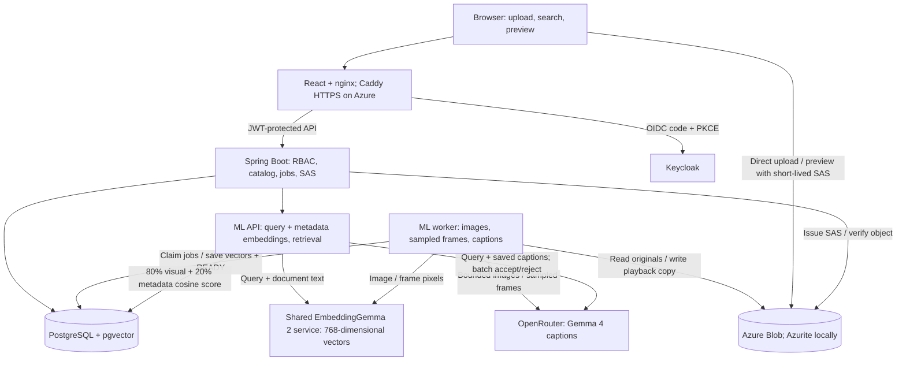
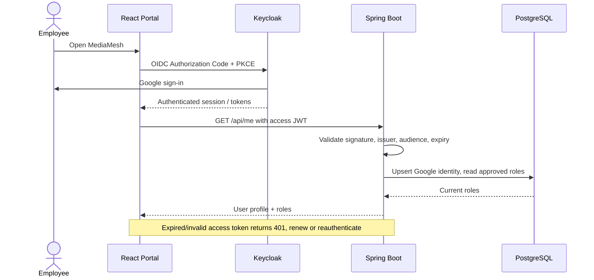
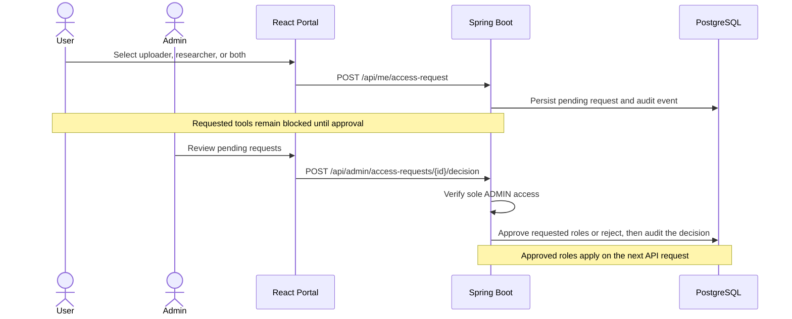
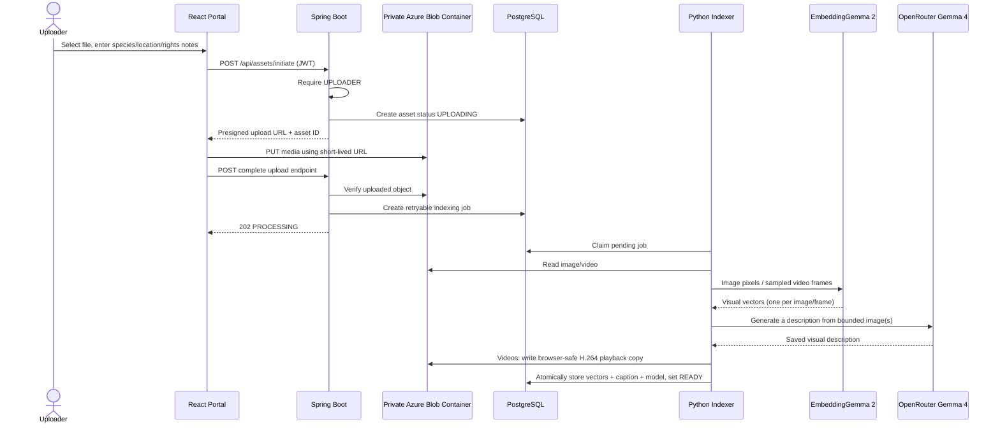
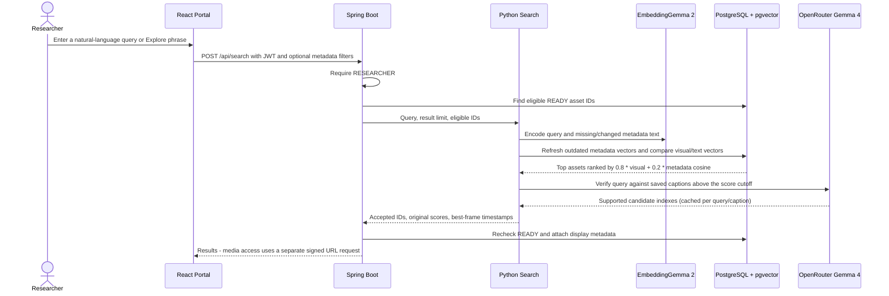
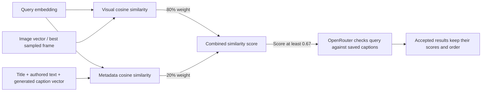
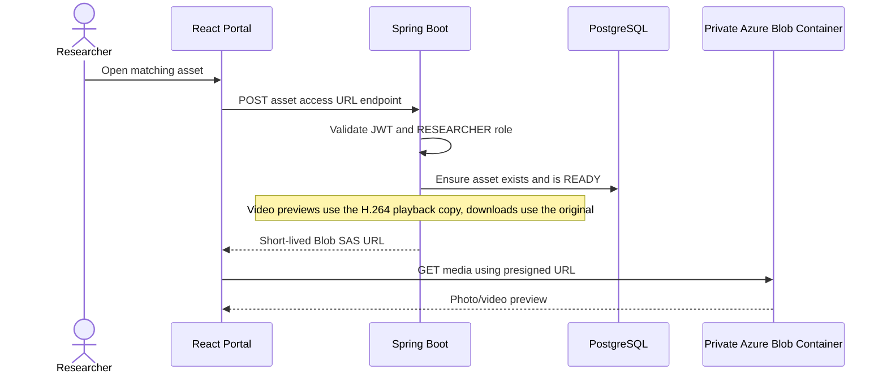

# MediaMesh — Enterprise Media Discovery for National Geographic

> **Status:** Integrated MVP implemented; local acceptance verified.
> **Context:** CMPE 272 student project. National Geographic is a **hypothetical enterprise customer scenario**; this is not an official NatGeo product or integration.

MediaMesh is a secure, searchable media library for editorial teams. A wildlife photographer or archive assistant can upload photographs and documentary clips to private object storage. A footage researcher can then search using natural language—without knowing filenames—and retrieve authorized photos or approximate matching video moments. A media administrator decides who can upload and who can search.

**Example:** A researcher preparing a feature on elephants searches for **“elephants drinking at a watering hole at sunset.”** MediaMesh finds visually similar photographs and sampled frames from documentary clips, and displays uploader-provided species, location, capture date, contributor and usage notes.

## Run the integrated application

Start Docker Desktop. Copy `.env.example` to `.env` if it does not exist, then
set `ML_OPENROUTER_API_KEY` in that ignored file. Captions and search verification
use the paid `google/gemma-4-26b-a4b-it` model; embeddings stay local. Then run:

```bash
./infra/start.sh
```

Open **http://localhost:8080**. First start downloads EmbeddingGemma 2 into its
Docker volume. Captions and verification use OpenRouter, so no local vision-model
download is needed. Track readiness with `./infra/manage.sh logs gemma-embed ml-api ml-worker`.

Configure `GOOGLE_CLIENT_ID` and `GOOGLE_CLIENT_SECRET` in `.env` using the
[Google OAuth setup](docs/ACCOUNT_SETUP.md), then select **Sign in with Google**.
Users choose uploader, researcher, or both and wait for approval. Sign in as
the Google email configured by `ADMIN_EMAIL` to open the sole administrator account and review requests.
Admin does not implicitly receive upload or search access. Legacy local password
fixtures are no longer accepted by the API.

For a populated nature showcase, sign in as the administrator and use the
**Seed** tab, which works locally and in deployment. Choose **20, 50, 100 or 500
images**, owned by the administrator. See the [demo setup and usage](infra/demo/README.md)
and [media attribution](ml-service/evaluation/DEMO_ATTRIBUTION.md).

See [the runbook](infra/README.md) for testing and Azure deployment.
Read [the implementation walkthrough](docs/IMPLEMENTATION.md)
to learn how the checkpoints fit together, and [the API contract](docs/contracts/README.md)
for routes and JSON examples. The historical team assignments below describe
workstream scope; Mathew now owns all workstreams.

The [course slide checklist](docs/COURSE_CHECKLIST.md) maps each security and
reliability requirement to implementation, tests, presentation evidence, and
account-owner steps that still need verification.

### Local Compose services

Use the service names below with `./infra/manage.sh`.

| Service | Component | When it runs |
| --- | --- | --- |
| `frontend` | React portal at `http://localhost:8080`, including the `/auth` proxy to Keycloak | Default stack |
| `backend` | Spring Boot API for the media catalog, access control, and search | Default stack |
| `postgres` | PostgreSQL with pgvector for catalog metadata, jobs, and embeddings | Default stack |
| `keycloak` | Local identity provider for sign-in and account provisioning | Default stack |
| `azurite` | Azure Blob Storage emulator at `http://localhost:10000` | Default stack |
| `blob-init` | Configures the Blob container and CORS before the backend starts | One-time startup job |
| `gemma-embed` | EmbeddingGemma 2 text and image encoders | Default stack |
| `ml-api` | FastAPI service for semantic search and model inference | Default stack |
| `ml-worker` | Background worker that indexes uploaded images and videos | Default stack |
| `prometheus` | Metrics and alert rules at `http://localhost:9090` | Default stack |
| `postgres-test` | Isolated PostgreSQL with pgvector for integration tests | `test` profile |
| `ml-tests` | Python lint and test runner | `test` profile |

```bash
./infra/manage.sh start ml-worker
./infra/manage.sh stop ml-worker
./infra/manage.sh restart ml-worker
./infra/manage.sh logs ml-worker
./infra/manage.sh status
```

Starting a service also starts its required dependencies. Stopping a service
keeps its container, logs, and data volumes. Run `./infra/manage.sh stop` to
stop the stack or `./infra/manage.sh help` for all commands. The `test`
profile is used by `./infra/check.sh`.

## Reliability and observability

For the final Azure student demo, use the separate [Azure VM + Blob Storage runbook](infra/deploy/README.md).
It includes HTTPS, fresh identities, managed-identity storage access, launch checks,
backups and recovery. The localhost stack is not a public deployment profile.

Semantic search now has a **99% / rolling 30-day SLO**: HTTP 200 within two
seconds for valid researcher requests. Prometheus at **http://localhost:9090**
shows search SLI, error-budget policies, two-window burn alerts, and ML
circuit-breaker/bulkhead metrics. A new installation reports partial history;
zero traffic does not imply 100% availability. No real paging receiver exists.

- [SLO, error budget, and incident runbook](docs/observability/SLO_ERROR_BUDGET.md)
- [Circuit breaker, bulkhead, error boundary, and local demonstrations](docs/observability/RESILIENCE_PATTERNS.md)

## MVP at a glance

| Capability | Scope |
|---|---|
| Enterprise authentication | OIDC single sign-on; JWT-protected Spring Boot APIs; defined access/session expiration |
| Admin-controlled RBAC | `ADMIN`, `UPLOADER`, `RESEARCHER` roles; role changes checked against current DB assignments |
| Media catalog | Photo and short video uploads; editorial metadata; processing states |
| Media storage | Private Azure Blob container for deployment; short-lived SAS upload/access links; Azurite locally |
| Natural-language discovery | EmbeddingGemma 2 visual/text embeddings; 80/20 cosine ranking; OpenRouter caption verification |
| Vector retrieval | PostgreSQL + pgvector; authorized, ready assets only |
| Recommendation | Basic related-media suggestions from vector similarity (no behavioral personalization) |
| Delivery | React frontend, Spring Boot API, Python ML service, Docker Compose, Jenkins CI |

**Explicitly out of scope for MVP:** custom distributed storage/replication, Kubernetes, Kafka/SQS, service mesh, LLM agent/MCP, native audio search/transcription, multi-tenant SaaS, comprehensive digital-rights clearance, per-collection confidential-content ACLs. Media rights notes are advisory; they do not authorize publication.

## System architecture

The diagrams below describe the current integrated stack (`compose.yaml`).
The [architecture guide](docs/architecture/README.md) explains the components,
scoring and deployment differences in more detail.



This describes **`compose.yaml`**, the current integrated stack. The separate
[Azure deployment reference](docs/architecture/azure-deployment-architecture.html)
tracks `compose.deploy.yaml`, which still defaults to CLIP and does not yet wire
in the shared EmbeddingGemma service or hybrid verification. Deploying that file
unchanged does **not** reproduce the local hybrid search path. See the
[deployment gap](infra/deploy/README.md#search-parity-with-the-integrated-stack).

**Security boundary:** Only the Caddy gateway is public (ports 80/443); Keycloak's admin console, metrics, the database and the Python services are not reachable from the internet. The browser never accesses internal Python endpoints directly. The backend validates JWTs and verifies current role assignments for each protected action. Media objects are private. SAS URLs are scoped and short-lived (15-minute create-only upload, 60-second read); role revocation cannot invalidate an already-issued URL before it expires.

## User roles

| Action | ADMIN | UPLOADER | RESEARCHER | Signed-in unassigned |
|---|:---:|:---:|:---:|:---:|
| Approve access, assign roles, delete users | Yes (sole designated admin) | No | No | No |
| Upload photos/video | Only with UPLOADER role | Yes | No | No |
| Edit own asset metadata | Only with UPLOADER role | Yes | No | No |
| Search media | Only with RESEARCHER role | No | Yes | No |
| Preview / download | Only with RESEARCHER role | No | Yes | No |

Roles can be combined. Users sign in with Google and request uploader, researcher, or both roles. Requests appear in the admin portal and grant access only after approval. The sole administrator is the Google email configured by `ADMIN_EMAIL`, bootstrapped on verified Google sign-in. See [account setup](docs/ACCOUNT_SETUP.md).

## Core workflows

### 1. Employee sign-in



### 2. User requests access and admin approves



### 3. Uploader adds wildlife footage



### 4. Researcher searches by natural language



### What the 80/20 score means

There are **two comparisons with the same query vector**. The first compares the
query with image pixels (or the best sampled video frame); the second compares
it with an embedding of the asset's title, authored description, species,
location and generated visual description. Both are cosine similarities:

```text
visual_score   = cosine(query_vector, image_vector)
                 or max cosine over the video's sampled frame vectors
metadata_score = cosine(query_vector, metadata_text_vector)
search_score   = 0.80 × visual_score + 0.20 × metadata_score
```



For example, visual similarity 0.80 and metadata similarity 0.60 produce 0.76.
The UI may show this as 76 similarity; it is **not a probability or accuracy
percentage**. The integrated default cutoff is 0.67. The database uses cosine
distance (`<=>`); the application converts it with `similarity = 1 - distance`.
These are vector comparisons, not an 80%/20% split of the uploaded file.

OpenRouter then filters the shortlist using saved captions. It does not inspect
the original files again during this check, recompute embeddings, or modify the
scores. A missing detail in a caption can hide a valid match. Broad Explore
phrases use alternatives such as “ocean scenes, waves, or coastlines”; precise
queries still require the requested subject, action, color and setting.

Metadata vectors are cached with a fingerprint of their source text. Before
search, the ML API generates missing vectors and refreshes those whose text has
changed. Editing a title therefore refreshes its text vector without re-embedding
the image. New visual vectors are generated during upload processing; search
reuses them. The first search after metadata changes can do additional work.

### 5. Authorized preview/download



## Technology stack

| Layer | Chosen MVP stack | Notes |
|---|---|---|
| Web UI | React | Role-aware editorial portal |
| Enterprise API | Java / Spring Boot / Spring Security | JWT and RBAC enforcement, asset catalog, orchestration |
| SSO | Keycloak 26 (OIDC, Authorization Code + PKCE) | Password + authenticator (TOTP); admin-created accounts only |
| Gateway | Caddy (deployment), nginx (portal) | HTTPS with Let's Encrypt; only ports 80/443 public |
| Media storage | Azure Blob Storage | Private container; create-only upload SAS and read-only preview/download SAS |
| Structured database | PostgreSQL | Users, roles, assets, indexing jobs, audit events |
| Vector database | pgvector | Vectors in the existing PostgreSQL database |
| ML retrieval | Python / FastAPI + shared EmbeddingGemma 2 | 768-dimensional visual/query/document vectors; hybrid retrieval |
| Captioning and verification | OpenRouter Gemma 4 26B A4B | Hosted image descriptions and batch query-to-caption checking |
| Video indexing | FFmpeg | Sample keyframes, report approximate matching timestamp; write H.264 playback copy |
| Monitoring | Prometheus | Search SLI, error budget and burn-rate rules |
| Deployment | Docker Compose on one Azure VM | `compose.deploy.yaml`; `compose.yaml` for local runs; single VM, not highly available |
| CI | Jenkins + GitHub Actions | Build, unit and integration tests |

## Repo organization

```text
Media-Mesh/
├── README.md
├── docs/
│   ├── architecture/           # Component diagram and deployment reference
│   ├── design/                 # NatGeo stakeholder architecture and design background
│   ├── team/                   # Shared plan plus four individual task assignments
│   └── contracts/              # Contract freeze and integration guidance
├── backend/                    # Teammates 1 and 2: separate Java packages
├── ml-service/                 # Teammate 3: embedding, indexing and retrieval
├── frontend/                   # Teammate 4: React portal
├── infra/                      # Teammate 4: local/deployment definitions
├── compose.yaml                # Local stack (Azurite, Keycloak dev realm)
├── compose.deploy.yaml         # Azure VM deployment
├── .github/workflows/          # GitHub Actions CI
└── Jenkinsfile                 # Jenkins pipeline
```

**The source directories now contain the integrated implementation.** Original team documents remain as design and ownership history; use the runbook and current API contract for executable instructions.

## Team ownership

| Teammate | Exclusive responsibility | Task document |
|---|---|---|
| Sonit | Enterprise identity, JWT, RBAC, admin APIs, audit | [Identity & RBAC](docs/team/01_PERSON_1_IDENTITY_RBAC.md) |
| Mathew | Media catalog, metadata APIs, S3, indexing job lifecycle | [Media Backend & S3](docs/team/02_PERSON_2_MEDIA_S3_BACKEND.md) |
| Sagar | EmbeddingGemma 2, hybrid retrieval, video keyframes, pgvector integration | [ML & Search](docs/team/03_PERSON_3_ML_RETRIEVAL.md) |
| Joel | React portal, local orchestration, Jenkins, integration demo | [Frontend & DevOps](docs/team/04_PERSON_4_FRONTEND_DEVOPS.md) |

Start with the [shared team overview and API contracts](docs/team/00_TEAM_OVERVIEW.md). Shared interface changes require a PR review before modifying another person's owned code.

## Project documentation

- [NatGeo stakeholder system design](docs/design/NATGEO_STAKEHOLDER_DESIGN.md) — detailed use case, exact metadata, decisions, five sequence flows.
- [Enterprise design background](docs/design/ENTERPRISE_DESIGN_BACKGROUND.md) — prior design rationale and alternatives.
- [Team work allocation](docs/team/00_TEAM_OVERVIEW.md) — ownership rules, routes, sample request/response payloads, checkpoints.
- [Integration guidelines](docs/contracts/README.md) — source ownership and contract freeze checklist.

## Acceptance demonstration

1. Employee signs in using OIDC and initially has no permissions.
2. Administrator grants `UPLOADER` and/or `RESEARCHER` role; revocation works without relying on stale JWT role claims.
3. Uploader sends a NatGeo-style wildlife photograph and a short documentary clip to private Blob Storage and supplies source metadata.
4. Indexing transitions from `UPLOADING` → `PROCESSING` → `READY`; duplicate completion does not double-index content.
5. Researcher searches **“elephants drinking at a watering hole at sunset”** and finds relevant images or video frames.
6. Researcher can preview/download authorized assets through short-lived URLs.
7. A user without permission receives `403`; an expired or invalid token receives `401`.
8. Docker local setup and Jenkins test pipeline are documented and demonstrable.

## Implemented MVP decisions

- Keycloak OIDC with Authorization Code + PKCE; JWT signature, issuer, audience
  and timestamp checks; current roles loaded from PostgreSQL on every request.
- Google sign-in, approval-based roles, and one verified Google administrator.
  In the cloud, accounts are created by an admin with a temporary password and
  mandatory TOTP enrollment. API
  sessions enforce 30-minute request-inactivity and 8-hour absolute limits;
  periodic `/me` polling counts as request activity. A separate frontend timer
  logs out after human inactivity. Logout revokes the local session and ends
  the provider session. Access JWTs last 15 minutes.
- Azure VM + private Blob Storage for cloud deployment; Azurite Blob Storage is the local demo fixture.
- JPEG, PNG, MP4 and QuickTime; 100 MB maximum at completion and 180-second
  video duration during indexing. PUT URLs expire in 15 minutes; GET in 60 seconds.
- Pinned EmbeddingGemma 2 model revision and 768-dimensional normalized vectors
  in the integrated stack; CLIP remains in standalone/deployment profiles.
  Workers invoke shared indexing functions and the private embedding service;
  no public embed-media endpoint exists.
- Related media uses one reference frame for videos. Search filters are applied
  to READY catalog IDs before similarity ranking. Exact search targets the small
  MVP catalog; large archives need database-side filtered vector indexing.

## Security and project hygiene

Never commit secrets, JWTs, OAuth credentials, Azure credentials/storage keys, private media objects, user records or trained model/data caches. Use environment variables and example configuration only. Upload rights notes are not a substitute for formal media licensing checks.

See [Azure Blob migration checkpoints](docs/AZURE_BLOB_MIGRATION.md) for the storage implementation and preservation of existing demo media.

See [account setup](docs/ACCOUNT_SETUP.md) for creating researcher, uploader and administrator logins and the first sign-in steps.

See [Azure demo data transfer](docs/AZURE_DEMO_DATA_TRANSFER.md) for the source checks, cloud accounts, import commands, validation and recovery steps.
