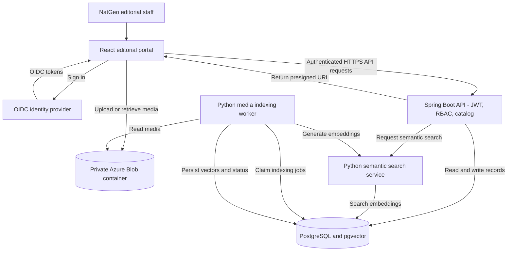
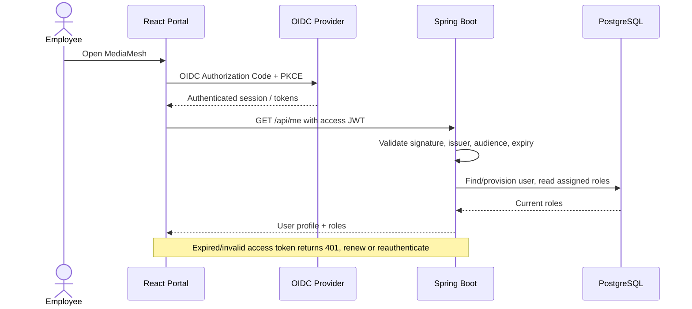
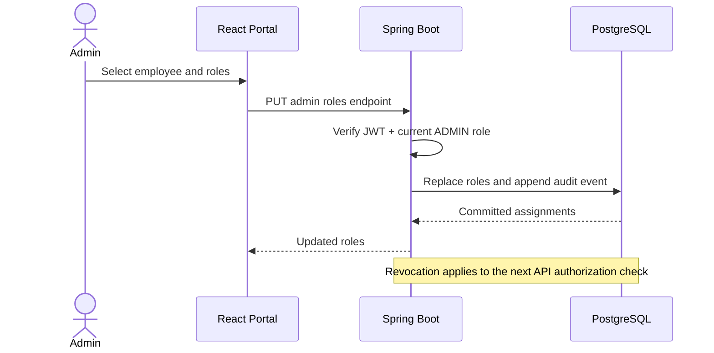
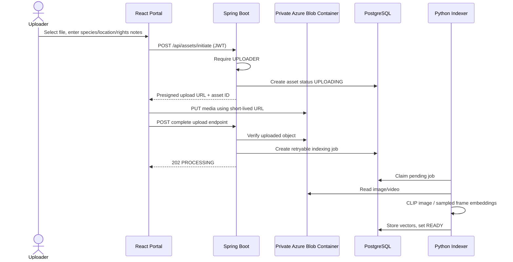
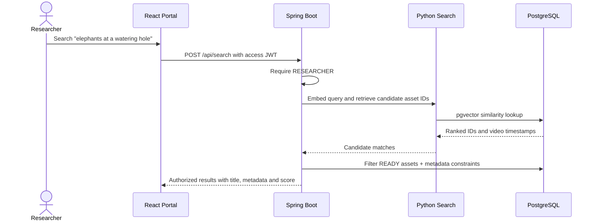
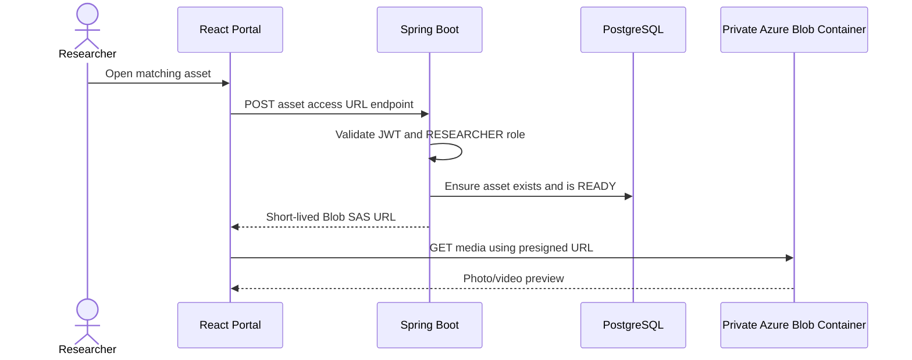
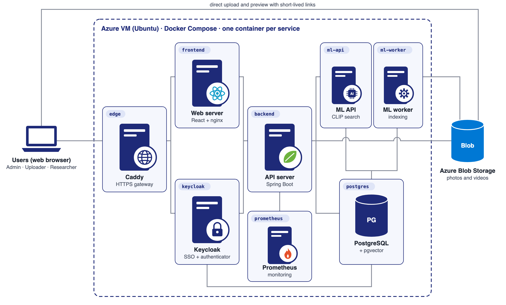

# MediaMesh — Enterprise Media Discovery for National Geographic

> **Status:** Integrated MVP implemented; local acceptance verified.
> **Context:** CMPE 272 student project. National Geographic is a **hypothetical enterprise customer scenario**; this is not an official NatGeo product or integration.

MediaMesh is a secure, searchable media library for editorial teams. A wildlife photographer or archive assistant can upload photographs and documentary clips to private object storage. A footage researcher can then search using natural language—without knowing filenames—and retrieve authorized photos or approximate matching video moments. A media administrator decides who can upload and who can search.

**Example:** A researcher preparing a feature on elephants searches for **“elephants drinking at a watering hole at sunset.”** MediaMesh finds visually similar photographs and sampled frames from documentary clips, and displays uploader-provided species, location, capture date, contributor and usage notes.

## Run the integrated application

Start Docker Desktop, then run:

```bash
./infra/start.sh
```

Open **http://localhost:8080**. First start downloads the pinned CLIP model;
watch `docker compose logs -f ml-api ml-worker` until it loads. Docker Compose
starts PostgreSQL/pgvector, Keycloak, the Azurite Blob emulator, Spring Boot, the ML API,
the indexing worker, and the React portal. Only the portal and local Blob port
are bound to localhost; Python has no host-facing port.

Local demo accounts: `admin`, `uploader`, `researcher`, `employee`; all use
`local-demo-only`. These are public local fixtures. Only `admin` gets a role
automatically. Sign in as the other users once so they appear in the Admin
screen, then assign `UPLOADER` and `RESEARCHER`. Use separate browser profiles
or sign out between accounts. Admin does not implicitly receive other roles.

For a populated nature showcase, run `./infra/seed-demo.sh` using Node.js 24
after starting the stack. It loads **48 photos and two videos** across wildlife,
plants, oceans, marine life, birds and landscapes, with a dedicated uploader for
each and a separate researcher. See the [demo accounts, setup and walkthrough](infra/demo/README.md)
and [media attribution](ml-service/evaluation/DEMO_ATTRIBUTION.md).

See [the runbook](infra/README.md) for testing, Azure deployment, and stopping
the stack. Read [the implementation walkthrough](docs/IMPLEMENTATION.md) to
learn how the checkpoints fit together, and [the API contract](docs/contracts/README.md)
for routes and JSON examples. The historical team assignments below describe
workstream scope; Mathew now owns all workstreams.

The [course slide checklist](docs/COURSE_CHECKLIST.md) maps each security and
reliability requirement to implementation, tests, presentation evidence, and
account-owner steps that still need verification.

## Reliability and observability

For the final Azure student demo, use the separate [Azure VM + Blob Storage runbook](infra/deploy/README.md).
It includes HTTPS, fresh identities, managed-identity storage access, launch checks,
backups and recovery. The localhost stack is not a public deployment profile.

Semantic search now has a **99% / rolling 30-day SLO**: HTTP 200 within two
seconds for valid researcher requests. Prometheus at **http://localhost:9090**
shows search SLI, error-budget policies, two-window burn alerts, and ML
circuit-breaker/bulkhead metrics. A new installation reports partial history;
zero traffic does not imply 100% availability. No real paging receiver exists.

- [SLO, error budget, and incident runbook](docs/observability/SLO_ERROR_BUDGET.md)
- [Circuit breaker, bulkhead, error boundary, and local demonstrations](docs/observability/RESILIENCE_PATTERNS.md)

## MVP at a glance

| Capability | Scope |
|---|---|
| Enterprise authentication | OIDC single sign-on; JWT-protected Spring Boot APIs; defined access/session expiration |
| Admin-controlled RBAC | `ADMIN`, `UPLOADER`, `RESEARCHER` roles; role changes checked against current DB assignments |
| Media catalog | Photo and short video uploads; editorial metadata; processing states |
| Media storage | Private Azure Blob container for deployment; short-lived SAS upload/access links; Azurite locally |
| Natural-language discovery | CLIP text/image embedding similarity; video search using sampled keyframes |
| Vector retrieval | PostgreSQL + pgvector; authorized, ready assets only |
| Recommendation | Basic related-media suggestions from vector similarity (no behavioral personalization) |
| Delivery | React frontend, Spring Boot API, Python ML service, Docker Compose, Jenkins CI |

**Explicitly out of scope for MVP:** custom distributed storage/replication, Kubernetes, Kafka/SQS, service mesh, LLM agent/MCP, native audio search/transcription, multi-tenant SaaS, comprehensive digital-rights clearance, per-collection confidential-content ACLs. Media rights notes are advisory; they do not authorize publication.

## System architecture



**Security boundary:** The browser never accesses internal Python endpoints directly. The backend validates JWTs and verifies current role assignments for each protected action. Media objects are private. Signed URLs are scoped and short-lived; role revocation cannot invalidate an already-issued URL before it expires.

## User roles

| Action | ADMIN | UPLOADER | RESEARCHER | Signed-in unassigned |
|---|:---:|:---:|:---:|:---:|
| Assign or revoke roles | Yes | No | No | No |
| Upload photos/video | Only with UPLOADER role | Yes | No | No |
| Edit own asset metadata | Only with UPLOADER role | Yes | No | No |
| Search media | Only with RESEARCHER role | No | Yes | No |
| Preview / download | Only with RESEARCHER role | No | Yes | No |

Roles can be combined. On first SSO login, an employee is provisioned without application roles. The team must configure a controlled first-admin bootstrap process.

## Core workflows

### 1. Employee sign-in



### 2. Admin assigns access



### 3. Uploader adds wildlife footage



### 4. Researcher searches by natural language



### 5. Authorized preview/download



## Technology stack

| Layer | Chosen MVP stack | Notes |
|---|---|---|
| Web UI | React | Role-aware editorial portal |
| Enterprise API | Java / Spring Boot / Spring Security | JWT and RBAC enforcement, asset catalog, orchestration |
| SSO | OIDC provider (to finalize) | Keycloak for local testing or enterprise OIDC-compatible IdP |
| Media storage | Azure Blob Storage | Private container; create-only upload SAS and read-only preview/download SAS |
| Structured database | PostgreSQL | Users, roles, assets, indexing jobs, audit events |
| Vector database | pgvector | Vectors in the existing PostgreSQL database |
| ML retrieval | Python / FastAPI, Pydantic, Uvicorn, Sentence Transformers / CLIP | Standalone multimodal embedding and semantic retrieval service |
| Video indexing | FFmpeg | Sample keyframes, report approximate matching timestamp |
| Local development | Docker Compose | Service reproducibility, not production orchestration |
| CI | Jenkins + GitHub | Build, unit and integration tests |

## Repo organization

```text
Media-Mesh/
├── README.md
├── docs/
│   ├── design/                 # NatGeo stakeholder architecture and design background
│   ├── team/                   # Shared plan plus four individual task assignments
│   └── contracts/              # Contract freeze and integration guidance
├── backend/                    # Teammates 1 and 2: separate Java packages
├── ml-service/                 # Teammate 3: embedding, indexing and retrieval
├── frontend/                   # Teammate 4: React portal
├── infra/                      # Teammate 4: local/deployment definitions
└── Jenkinsfile                 # Added when CI is implemented
```

**The source directories now contain the integrated implementation.** Original team documents remain as design and ownership history; use the runbook and current API contract for executable instructions.

## Team ownership

| Teammate | Exclusive responsibility | Task document |
|---|---|---|
| Sonit | Enterprise identity, JWT, RBAC, admin APIs, audit | [Identity & RBAC](docs/team/01_PERSON_1_IDENTITY_RBAC.md) |
| Mathew | Media catalog, metadata APIs, S3, indexing job lifecycle | [Media Backend & S3](docs/team/02_PERSON_2_MEDIA_S3_BACKEND.md) |
| Sagar | CLIP embeddings, retrieval, video keyframes, pgvector integration | [ML & Search](docs/team/03_PERSON_3_ML_RETRIEVAL.md) |
| Joel | React portal, local orchestration, Jenkins, integration demo | [Frontend & DevOps](docs/team/04_PERSON_4_FRONTEND_DEVOPS.md) |

Start with the [shared team overview and API contracts](docs/team/00_TEAM_OVERVIEW.md). Shared interface changes require a PR review before modifying another person's owned code.

## Project documentation

- [NatGeo stakeholder system design](docs/design/NATGEO_STAKEHOLDER_DESIGN.md) — detailed use case, exact metadata, decisions, five sequence flows.
- [Enterprise design background](docs/design/ENTERPRISE_DESIGN_BACKGROUND.md) — prior design rationale and alternatives.
- [Team work allocation](docs/team/00_TEAM_OVERVIEW.md) — ownership rules, routes, sample request/response payloads, checkpoints.
- [Integration guidelines](docs/contracts/README.md) — source ownership and contract freeze checklist.

## Acceptance demonstration

1. Employee signs in using OIDC and initially has no permissions.
2. Administrator grants `UPLOADER` and/or `RESEARCHER` role; revocation works without relying on stale JWT role claims.
3. Uploader sends a NatGeo-style wildlife photograph and a short documentary clip to private Blob Storage and supplies source metadata.
4. Indexing transitions from `UPLOADING` → `PROCESSING` → `READY`; duplicate completion does not double-index content.
5. Researcher searches **“elephants drinking at a watering hole at sunset”** and finds relevant images or video frames.
6. Researcher can preview/download authorized assets through short-lived URLs.
7. A user without permission receives `403`; an expired or invalid token receives `401`.
8. Docker local setup and Jenkins test pipeline are documented and demonstrable.

## Implemented MVP decisions

- Keycloak OIDC with Authorization Code + PKCE; JWT signature, issuer, audience
  and timestamp checks; current roles loaded from PostgreSQL on every request.
- Public local demo identities; one explicit bootstrap admin subject. API
  sessions enforce 30-minute idle and 8-hour absolute limits; logout revokes
  the local session and ends the provider session. Access JWTs last 15 minutes.
- Azure VM + private Blob Storage for cloud deployment; Azurite Blob Storage is the local demo fixture.
- JPEG, PNG, MP4 and QuickTime; 100 MB maximum at completion and 180-second
  video duration during indexing. PUT URLs expire in 15 minutes; GET in 60 seconds.
- Frozen CLIP model revision and 512-dimensional normalized vectors. Workers
  invoke shared Python indexing functions directly; no embed-media HTTP endpoint.
- Related media uses one reference frame for videos. Search filters are applied
  to READY catalog IDs before similarity ranking. Exact search targets the small
  MVP catalog; large archives need database-side filtered vector indexing.

## Security and project hygiene

Never commit secrets, JWTs, OAuth credentials, Azure credentials/storage keys, private media objects, user records or trained model/data caches. Use environment variables and example configuration only. Upload rights notes are not a substitute for formal media licensing checks.

See [Azure Blob migration checkpoints](docs/AZURE_BLOB_MIGRATION.md) for the storage implementation and preservation of existing demo media.



See the [detailed deployment reference](docs/architecture/azure-deployment-architecture.html) for every container, network path and Azure resource in the live deployment.

See [account setup](docs/ACCOUNT_SETUP.md) for creating researcher, uploader and administrator logins and the first sign-in steps.

See [Azure demo data transfer](docs/AZURE_DEMO_DATA_TRANSFER.md) for the source checks, cloud accounts, import commands, validation and recovery steps.
